# Information Security

## Bài 1: Tạo app Windowns Form App C# net4.8 - WinForms có các chức năng: 
1. sinh khóa AES
2. Lưu khóa ra file
3. Import khóa từ file
4. Mã hóa 1 đoạn văn bản hiển thị kết quả ra màn hình
5. Mã hóa 1 file lưu vào 1 file

<!> Yêu cầu: file đầu vào > 1GB, tính toán thời gian mã hóa, thời gian giả mã, so sánh theo bytes file nguồn và file giải mãi, kết luận theo số liệu thu được

---

[1] Tab 1: Quản lý khóa, mã hóa văn bản

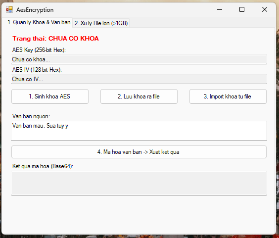

[2] Sinh khóa: Nhấn nút "1. Sinh khoa AES" kiểm tra thông tin khóa Key (64 ký tự Hex) và IV (32 ký tự Hex) xuất hiện đầy đủ tại 2 ô TextBox.

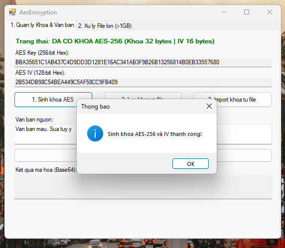

[3] Lưu khóa ra file: Nhấn nút "2. Luu khoa ra file"

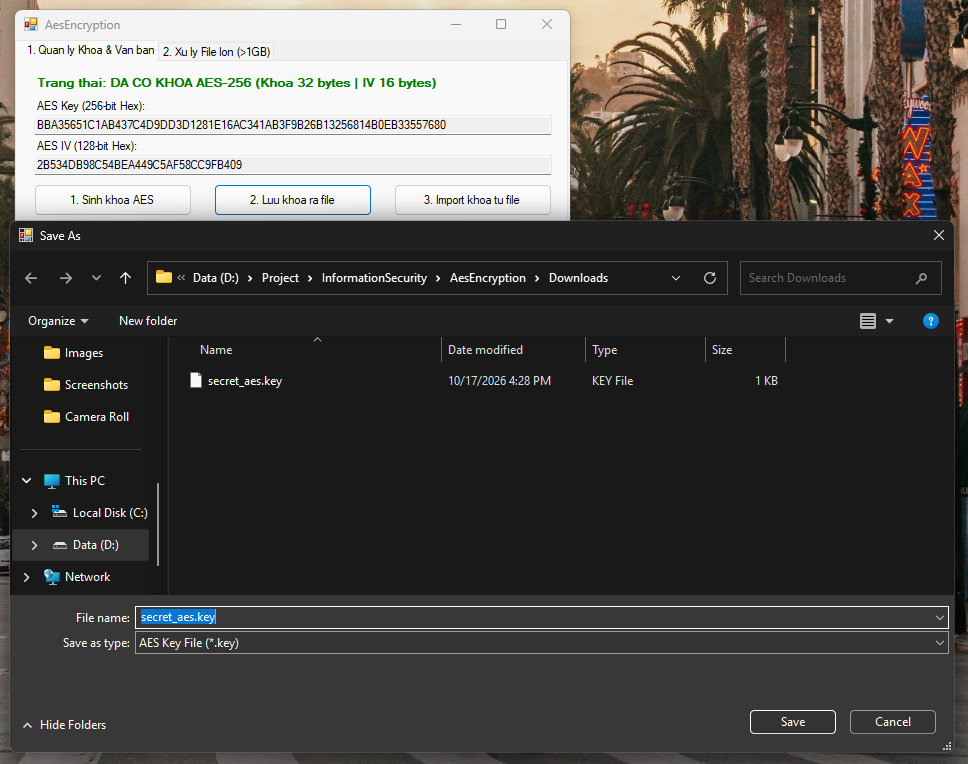

[4] Import khóa từ file

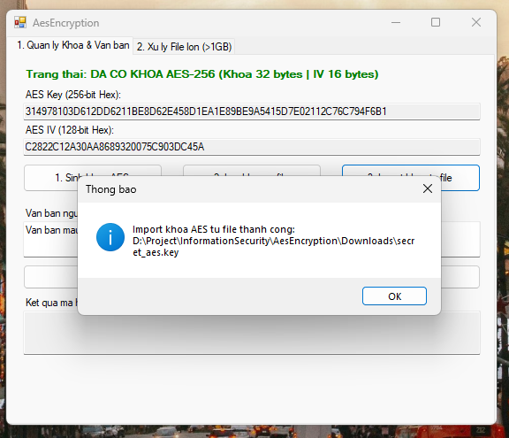

[5] Thử mã hóa văn bản

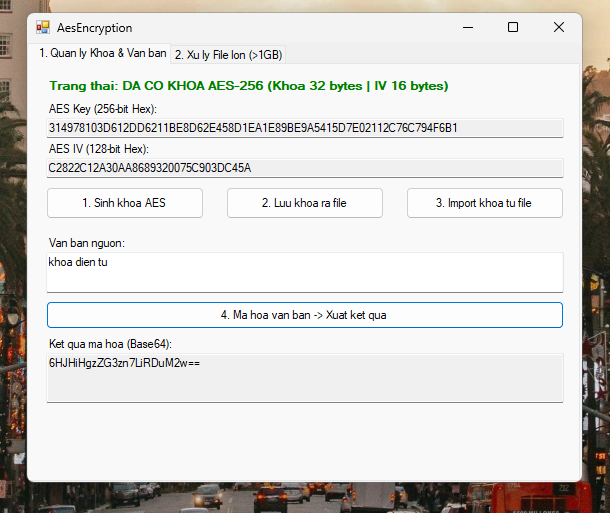

[6] Tab 2: Xử lý file lớn hơn 1GB

Khi chưa có khóa, hệ thống sẽ hiển thị cảnh báo yêu cầu người dùng sinh hoặc import khóa ở Tab 1 trước khi tiến hành chọn file.

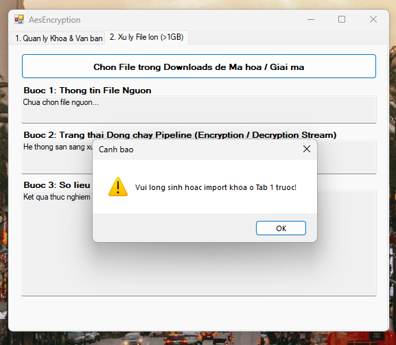

Chọn file nguồn cần mã hóa trong thư mục Downloads để hệ thống tự động đưa vào dòng chảy Pipeline (mã hóa tạo file .aes và giải mã ngược lại tạo file .dec).

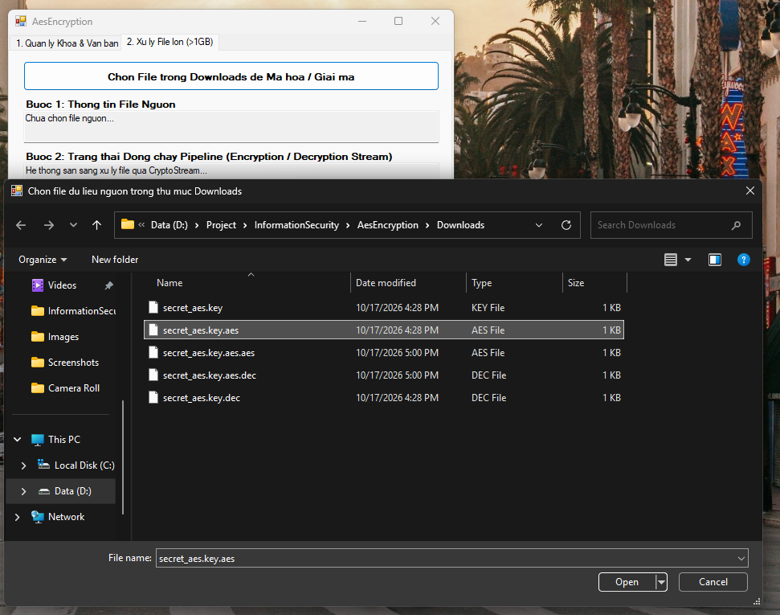

Kết quả thực nghiệm hiển thị đầy đủ thời gian thực thi (mã hóa, giải mã) và kết quả kiểm tra toàn vẹn so sánh từng byte giữa file gốc và file giải mã đạt độ chính xác 100%.

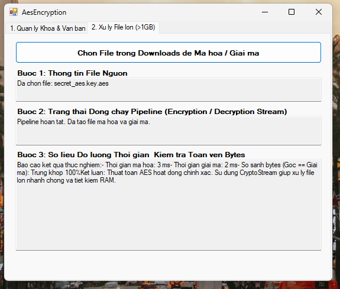
## Bài 2: Tạo app Windowns Form App C# net4.8 - WinForms có các chức năng: 
1. sinh khóa RSA
2. Xuất khóa ra file pem
3. Hiển thị kết quả ra màn hình (ý nghĩa các byte trong format pem)
4. Nhập file pem (Public/Private)
5. Mã hóa dữ liệu (<= 190 bytes) ra file
6. Giải mã và kiểm tra, 
7. Đánh giá tốc độ mã hóa/giải mã
8. Hiệu ứng tuyết lở SHA-256
9. Chữ ký số RSA-PSS đảm bảo khác nhau mỗi lần ký
---
[1] Tab 1: Quản lý khóa RSA, Xuất PEM & Phân tích cấu trúc Byte ASN.1
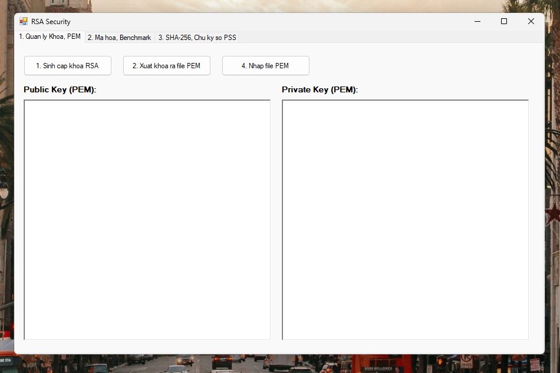
[2] Sinh cặp khóa RSA: Nhấn nút "1. Sinh cap khoa RSA" kiểm tra thông tin chuỗi Public Key và Private Key chuẩn PEM xuất hiện đầy đủ tại 2 ô RichTextBox.
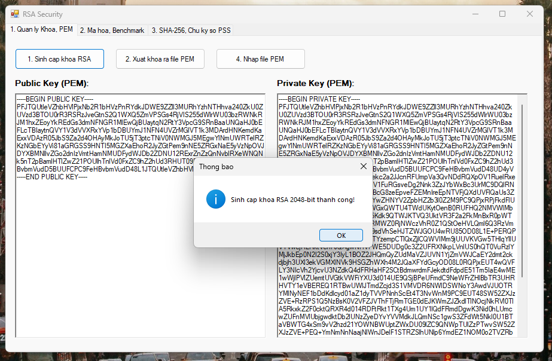
[3] Xuất khóa ra file PEM: Nhấn nút "2. Xuat khoa ra file PEM" để lưu các file public_key.pem và private_key.pem vào thư mục Downloads, đồng thời hiển thị thông tin giải mã ý nghĩa các byte theo chuẩn ASN.1 TLV ra màn hình.
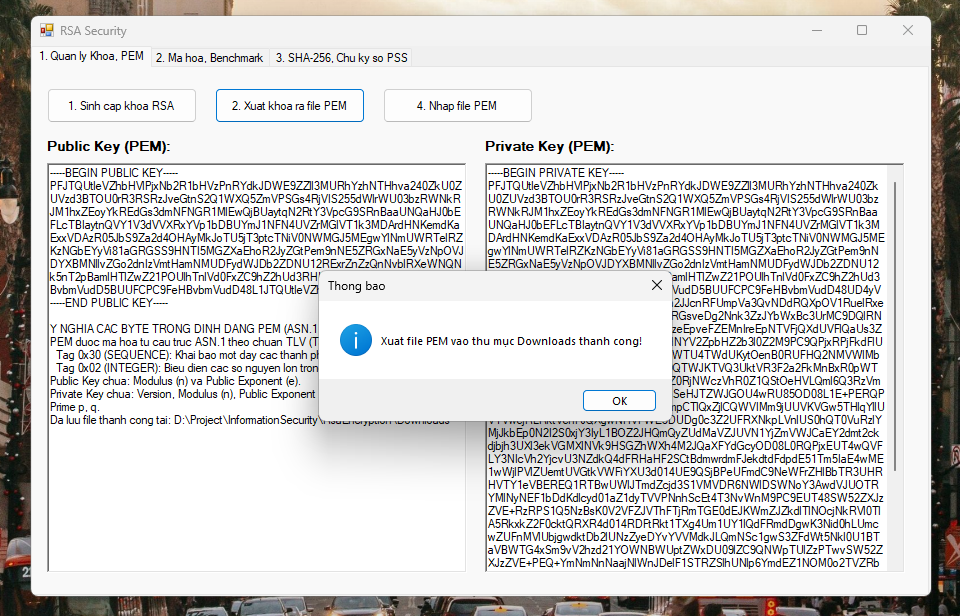
[4] Nhập file PEM: Nhấn nút "4. Nhap file PEM" chọn file khóa công khai hoặc khóa bí mật từ thư mục Downloads để nạp vào hệ thống.
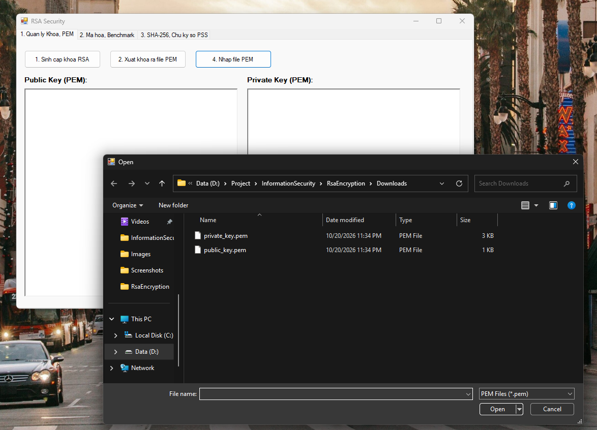
[5] Tab 2: Mã hóa, Giải mã dữ liệu & Đánh giá Hiệu năng Performance
[6] Mã hóa dữ liệu (<= 190 bytes): Nhập chuỗi văn bản hoặc khóa AES cần mã hóa, nhấn nút "5. Ma hoa du lieu" để sử dụng Public Key mã hóa theo chuẩn PKCS#1 v1.5 thành mảng byte dạng Base64 và lưu ra file encrypted_data.enc trong thư mục Downloads.
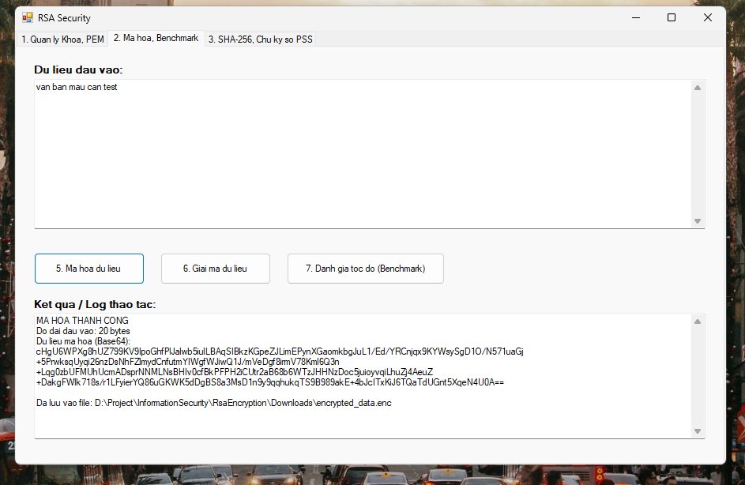
[7] Giải mã dữ liệu: Nhấn nút "6. Giai ma du lieu" để đọc file encrypted_data.enc, dùng Private Key giải mã ngược lại thành văn bản gốc và kiểm tra so sánh khớp 100% toàn vẹn dữ liệu.

[8] Đánh giá tốc độ mã hóa/giải mã (Benchmark): Nhấn nút "7. Danh gia toc do (Benchmark)" để hệ thống chạy 500 vòng lặp đo thời gian thực thi. Kết quả chứng minh mã hóa bằng Public Key (số mũ e nhỏ) chạy rất nhanh, trong khi giải mã bằng Private Key (số mũ d lớn) tốn nhiều thời gian tính toán hơn.

[9] Tab 3: Mã băm SHA-256 & Chữ ký số RSA-PSS độc lập mỗi lần ký
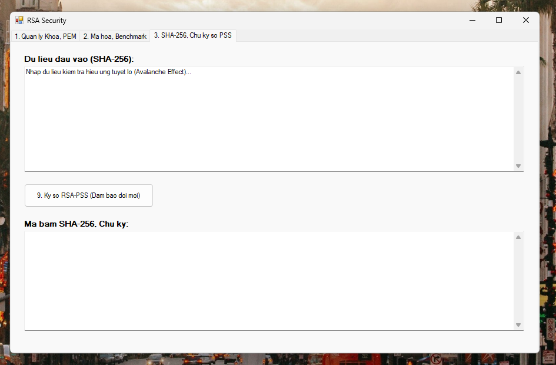
[10] Hiệu ứng tuyết lở SHA-256 (Avalanche Effect): Nhập văn bản đầu vào tại ô text, khi thay đổi dù chỉ 1 ký tự nhỏ, mã băm SHA-256 đầu ra sẽ thay đổi hoàn toàn hoàn toàn khác biệt (đảo khoảng 50% số bit).
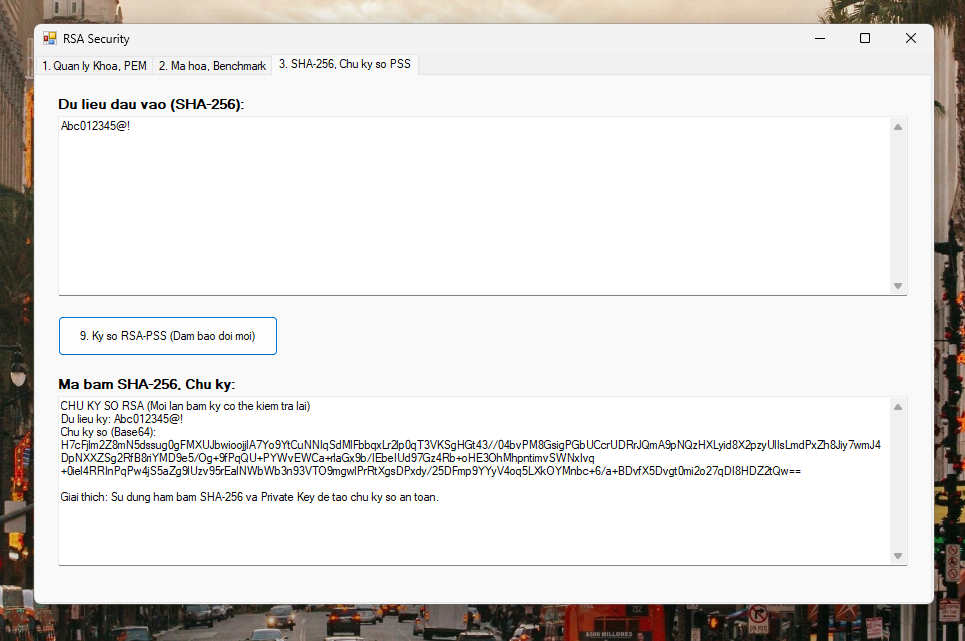
[11] Chữ ký số RSA-PSS: Nhấn nút "9. Ky so RSA-PSS" để sử dụng Private Key và cơ chế chèn chuỗi Salt ngẫu nhiên. Kết quả thực nghiệm xác nhận cùng 1 dữ liệu và cùng 1 người ký nhưng mỗi lần nhấn ký sẽ sinh ra các chữ ký số hoàn toàn khác nhau.